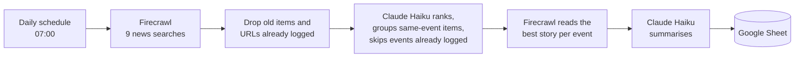

# AI News Research Assistant

A scheduled research assistant. Every morning it finds the day's important AI news, picks the stories that matter, writes a short summary of each, and adds them to a Google Sheet. It runs by itself on [Trigger.dev](https://trigger.dev), with **no server and no manual step**, and costs a few rand (well under a dollar) a month.

It tracks four topics: M&A and funding, model releases, products and tools, and policy and regulation.

## What you get

A Google Sheet with two tabs.

**News**: one row per story.

| Date | Category | Importance | Headline | Companies | Summary | Why it matters | Source | URL |
|---|---|---|---|---|---|---|---|---|

Importance runs from 1 to 5. Only stories at or above `minImportance` (default 4) are logged. The Category cell is colour-coded, and the top stories are highlighted.

**Runs**: one row per run with stories found, kept and written, Firecrawl credits used, tokens, estimated cost, seconds and any errors. This is your cost and health history, because Trigger.dev keeps run logs for only one day on its free plan.

## How it works



- **Safe to re-run:** a story already in the Sheet is never added again, checked by URL and by event (the same news from a different outlet). The event check is the model's judgement, so an occasional repeat or missed follow-up is possible.
- **Fault tolerant:** if an article cannot be read, the search snippet is used. If one search fails the others still run. If everything fails the run fails, retries three times with backoff, and Trigger.dev can email you.
- **Safe with untrusted web pages:** the model returns validated JSON and has no tools, so a web page cannot make it act.
- **Copyright-friendly:** only short summaries and links are stored, never article text.

## Requirements

- Node.js 20 or newer
- An [Anthropic API key](https://console.anthropic.com/) (pay-per-use)
- A [Firecrawl](https://www.firecrawl.dev/) API key (free plan: 1,000 credits a month)
- A Google account, and a Google Cloud project for a service account (free)
- A [Trigger.dev](https://trigger.dev) account (free plan) for the scheduled run. Not needed to try it locally.

## Setup

### 1. Install and add your keys
```
npm install
cp .env.example .env     # Windows: copy .env.example .env
```
Fill in `.env` (it is git-ignored, never commit it):

| Variable | Where to get it |
|---|---|
| `ANTHROPIC_API_KEY` | Anthropic Console. A dedicated key for this project keeps its spend visible |
| `FIRECRAWL_API_KEY` | firecrawl.dev dashboard |
| `GOOGLE_SERVICE_ACCOUNT_B64` | Service account JSON key, base64-encoded on one line (step 2) |
| `GOOGLE_SHEET_ID` | The long part of the Sheet's URL between `/d/` and `/edit` |

### 2. Google Sheet access (a service account, so nothing expires)
A service account is a robot identity. Unlike a normal sign-in it never needs a browser and its access does not expire, which suits an unattended job.

1. In the [Google Cloud Console](https://console.cloud.google.com/), pick or create a project and enable the **Google Sheets API**.
2. Go to IAM and Admin, Service accounts, and create one. No roles are needed.
3. Open it, then Keys, Add key, Create new key, JSON. Save the file somewhere outside this folder.
4. Create a Google Sheet and **share it with the service account's email as Editor**.
5. Encode the key to one line and copy it to the clipboard, then paste it after `GOOGLE_SERVICE_ACCOUNT_B64=` in `.env`:
   ```powershell
   [Convert]::ToBase64String([IO.File]::ReadAllBytes("C:\path\to\key.json")) | Set-Clipboard
   ```
   On Linux use `base64 -w0 key.json`. On macOS use `base64 -i key.json | tr -d '\n'`.

The service account can only see Sheets shared with it. The News and Runs tabs, header and colours are created automatically on the first live run.

### 3. Try it locally (no Trigger.dev needed)
```
npm run local              # dry run: search, rank, read, summarise and print. Writes nothing
npm run local -- --live    # the same, and writes to the Sheet
npm test                   # offline tests
```
A dry run needs only the Anthropic and Firecrawl keys. Each run uses about 20 to 26 Firecrawl credits, so avoid many manual runs on the free plan.

### 4. Schedule it on Trigger.dev
1. Create a project in the Trigger.dev dashboard and copy its **project ref** (it starts with `proj_`). Put it in [`trigger.config.ts`](trigger.config.ts) in place of the existing one. It is an identifier, not a secret.
2. Log in once and test in the dev environment:
   ```
   npx trigger.dev@latest login
   npm run dev
   ```
   In the dashboard (Dev environment, Test page), run the task `ai-news-manual` with the payload `{ "dryRun": true }`.
3. Add your four variables in the dashboard under **Environment variables** for the **Production** environment, ticking Secret on each. **Production does not read your `.env`.**
4. Create an alert: Alerts, New alert, Email, "Run fails".
5. Deploy:
   ```
   npm run deploy
   ```
6. On the Schedules page, `daily-ai-news` should show a next run at 07:00 in your timezone. To change the time or timezone, edit `cron` in [`trigger/daily-ai-news.ts`](trigger/daily-ai-news.ts) and deploy again.

Two tasks exist: `daily-ai-news` (the schedule, production only) and `ai-news-manual` (run it from the dashboard with `{ "dryRun": true }` to test without writing to the Sheet).

## Configuration

Everything you might tune is in [`src/config.ts`](src/config.ts): the reader the briefing is written for (`audience`), the search queries, how old a story can be, the minimum importance, how many stories per day, and the Claude model.

## Cost

About R2 to R4 (roughly $0.13 to $0.25) a month, almost all of it Anthropic. Firecrawl uses about 780 of the free 1,000 monthly credits and Trigger.dev stays inside its free plan. Figures from dry runs, details in [docs/cost-estimate.md](docs/cost-estimate.md).

## Project structure

```
trigger/daily-ai-news.ts   the scheduled task and the manual test task
src/pipeline.ts            the whole daily job
src/firecrawl.ts           news search and page reading (REST)
src/claude.ts              ranking and summarising
src/dedupe.ts              dates, freshness and duplicate removal
src/sheets.ts              Google Sheets, tabs and styling
src/config.ts              settings
src/local.ts               run the job from your machine
tests/                     offline tests (Firecrawl, Claude and Sheets are mocked)
trigger.config.ts          Trigger.dev project settings
docs/cost-estimate.md      running cost
```

## Known limitations
- Firecrawl's free plan allows about 10 requests a minute and 2 at once, so a run takes a minute or two.
- News dates are sometimes missing or relative ("2 hours ago"). Stories with an unknown date are kept, and the Sheet check removes repeats.
- The model can misjudge importance or miss a story. Treat the Sheet as a briefing, not a complete record.
- Trigger.dev's free plan keeps logs for 1 day and allows one alert destination.
- It reads public news only. No personal data is processed.

## Licence

[MIT](LICENSE). You are free to use, modify and sell this software, including for commercial work, as long as the copyright notice is kept.
